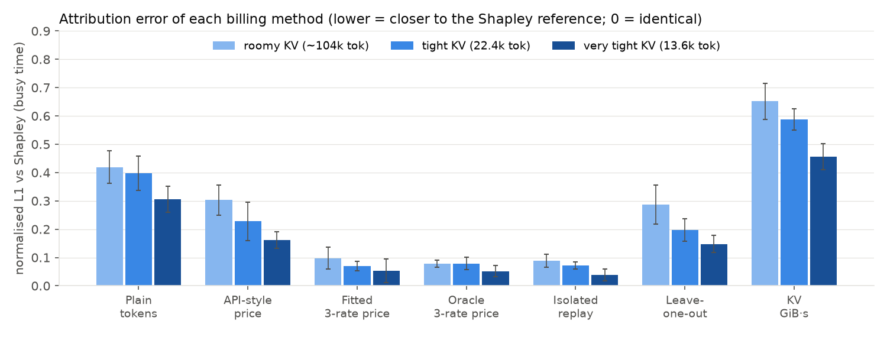
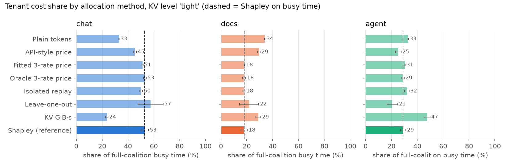
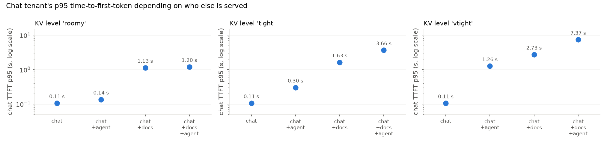
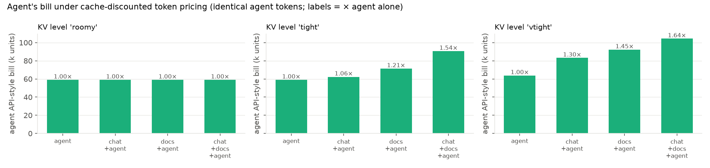

# FairShare PoC — does token billing misallocate shared-GPU cost, and do better token prices fix it?

A laptop-scale experiment that produces evidence for (or against) the FairShareAI problem statement. It is **not** a partial build of the proposed system: there is no gateway, no ledger service, no scheduler.

## Question

Three tenants with roughly **equal token volume** share one vLLM engine. Does each tenant's share of the GPU cost match its token share? If not:
- is the gap closed by the *differentiated* token prices that APIs already use (output ≈ 5× input, cached input 0.1×), or by a 3-rate price fitted to measurements?
- does one tenant's presence measurably harm another (latency, cache hits)?

## Method

| Element | Choice |
|---|---|
| Engine | vLLM 0.30.0 (V1 engine), prefix caching on, chunked prefill default (8,192 tokens per step), block size 16 |
| Model | Qwen2.5-0.5B-Instruct, fp16 |
| Hardware | RTX 3050 Laptop GPU, 4 GB, 80 W cap |
| Cache isolation | Per-tenant `cache_salt`: no cross-tenant prefix reuse. Tenants still share the physical block pool. |
| KV capacity | `roomy` ≈ 104k tokens (everything fits); `tight` = 1,400 blocks = 22.4k tokens; `vtight` = 850 blocks = 13.6k tokens, about 1.1 × the largest request (heavy preemption). `vtight` uses `max_model_len` 13,568 (the pool must hold one full-length request); all requests are ≤ 12.4k tokens, so the workload is unchanged. |
| Tenants | **chat**: ~127 requests, 256–1,024-token prompt, 128-token output, Poisson arrivals over 60 s. **docs**: ~10 requests, 6k–12k-token prompt, 128-token output, uniform arrivals. **agent**: 4 sessions × 6 dependent turns, context grows from 1k to ~6.5k by appending the previous output plus 700–1,000 "tool result" tokens, 256-token output, 0.5–2 s tool delays, full prefix reuse within a session. |
| Token matching | Each tenant ≈ 97–101k tokens (prompt + output) per seed |
| Prompts | Random token IDs (`workload.py`), so prefix relationships are exact. Outputs are forced to length with `ignore_eos`, so every replay does the same token work. |
| Replays | All 7 non-empty tenant coalitions, same requests and arrival times each time, in random order. Plus one repeat of the full coalition as a noise floor. 4 seeds × 3 KV levels = 96 runs. |
| Cost C(S) | **Primary:** busy time, the sum of `engine.step()` durations (GPU work plus engine overhead; idle gaps excluded). **Secondary:** dynamic GPU energy, NVML energy-counter delta minus idle power × duration (JouleShare's definition). |
| Reference | Exact 3-player Shapley value of C(S) |
| Compared allocations | plain token share; API-style price (1 × uncached input + 0.1 × cached input + 5 × output); 3-rate price fitted by NNLS to *isolated* per-tenant costs on the other seeds (what an operator could calibrate from benchmarks); 3-rate price fitted directly to Shapley values on the other seeds (the best a linear token price can do); isolated replay; leave-one-out; logical KV GiB·s |
| Metric | Normalised L1 = Σ over tenants of \|share − Shapley share\|, as in JouleShare. 0 = identical; 2 = completely disjoint. Also the per-tenant deviation in percentage points. |
| Externality | Chat time-to-first-token (TTFT) and time-per-output-token (TPOT) at p50/p95, alone vs with others; agent prefix-cache hit rate alone vs with others |

## How to run

```bash
# one-off: venv with vLLM (~7.8 GB) — set TMPDIR/UV_CACHE_DIR to a real disk if /tmp is a small tmpfs
uv venv --python 3.12 .venv && VIRTUAL_ENV=.venv uv pip install vllm pynvml pandas numpy matplotlib scipy

# experiments (~110 min on the RTX 3050; one engine start per KV level)
for L in roomy tight vtight; do .venv/bin/python run_experiments.py --seeds 0 1 2 3 --kv-levels $L --repeat-grand 1; done

# analysis (seconds): writes results/summary.md, results/summary.json, figures/*.png
.venv/bin/python analyze.py
```

Files:
- `workload.py`: tenant generator
- `run_experiments.py`: coalition replay and measurement
- `analyze.py`: Shapley, baselines, tables, figures
- `results/runs.jsonl`: raw per-run, per-request data
- `results/pilot.jsonl`: pilot run used to choose the load level; not part of the analysis
- `pick_gpu.py`, `run.pbs`: GPU selection and PBS job script for the shared RU cluster (below)
- `compare_7b.py`: laptop vs RU A100 (Qwen2.5-7B) comparison figures; write-up in `results/qwen2.5-7b-instruct/experiment_summary.md`

### Running on a shared GPU cluster (RU)

RU's A100s are shared and not isolated between jobs, so other users' work can inflate busy time and energy. `run_experiments.py` guards every replay:
- **Before:** it waits until the GPU shows 0% utilisation for 3 s while our engine is idle (`--quiet-s`, `--max-wait-s`).
- **During:** it samples other processes on the GPU and their SM utilisation every 0.5 s.
- **After:** it re-checks utilisation for 2 s.

A replay that fails any check is written with `contaminated: true`, giving the reasons, and is retried up to 3 times. `analyze.py` ignores contaminated rows. After 8 contaminated attempts in a row the job stops, because the GPU is too busy. Rows already measured cleanly are skipped, so you can simply resubmit the job.

`run.pbs` also only starts on a GPU that has enough free memory and at most `PICK_MAX_UTIL` (default 5) % utilisation over a 10 s sample, waiting up to `PICK_WAIT` seconds (default 1800) for one. On 2026-11-14 a smoke test on a GPU that other jobs kept about 50% busy was contaminated on all 3 attempts, so starting on a busy GPU is pointless.

This is detection, not isolation. CPU contention on the node also affects busy time; `cpus_allowed` and `loadavg_1m` are recorded but not used to flag runs. Final numbers should come from an exclusive GPU where possible.

```bash
qsub -v KV=roomy,SEEDS=0,ONLY=chat,WINDOW=20,REPEAT=0,OUT=results/smoke/runs.jsonl -l walltime=00:40:00 run.pbs   # smoke test
qsub -v KV=roomy run.pbs                                     # Qwen2.5-7B, results/qwen2.5-7b-instruct/runs.jsonl
python analyze.py --runs results/qwen2.5-7b-instruct/runs.jsonl   # figures go to results/qwen2.5-7b-instruct/figures
```

The defaults (`--model` Qwen2.5-0.5B, `--dtype float16`, `--gpu-mem-util 0.80`) reproduce the laptop setup. Larger models must use the Qwen2.5 tokenizer, because the workload draws random token IDs up to 150,000.

## Results

**Setup recap.** Qwen2.5-0.5B on vLLM 0.30, RTX 3050 Laptop GPU. Three tenants with about equal token volume (≈ 97–101k tokens each): chat (many short requests), docs (few 6–12k-token prompts), agent (multi-turn, growing, cached context). Caches are isolated per tenant. All 7 tenant coalitions were replayed for 4 seeds at 3 KV-memory levels, 96 runs in total. Reference: exact Shapley value of GPU busy time, with dynamic energy as a second reference. Run-to-run noise (repeat of the full coalition) was ≤ 0.003 normalised L1, so every difference below is far above measurement noise.

**Finding 1 — Plain token billing is substantially wrong, at the same magnitude JouleShare reported, but in the opposite direction to the proposal's headline example.**

| Normalised L1 vs Shapley (busy time), mean ± SD over 4 seeds | roomy KV | tight KV | very tight KV |
|---|---|---|---|
| Plain tokens | 0.42 ± 0.06 | 0.40 ± 0.06 | 0.31 ± 0.05 |
| API-style price (in 1, cached 0.1, out 5) | 0.30 ± 0.05 | 0.23 ± 0.07 | 0.16 ± 0.03 |
| 3-rate price fitted on *isolated* benchmarks (held-out seed) | 0.10 ± 0.04 | 0.07 ± 0.02 | 0.05 ± 0.04 |
| 3-rate price fitted on Shapley (best any linear token price can do) | 0.08 ± 0.01 | 0.08 ± 0.02 | 0.05 ± 0.02 |
| Isolated replay | 0.09 ± 0.02 | 0.07 ± 0.01 | 0.04 ± 0.02 |
| Leave-one-out marginal | 0.29 ± 0.07 | 0.20 ± 0.04 | 0.15 ± 0.03 |
| Logical KV GiB·s | 0.65 ± 0.06 | 0.59 ± 0.04 | 0.46 ± 0.05 |

The energy reference gives nearly identical numbers (plain tokens 0.41 / 0.38 / 0.29; see `results/summary.md`).

- Token shares are ≈ 33% each. Shapley busy-time shares are **chat 54% / docs 17% / agent 29%** (roomy), moving to 48% / 21% / 31% under very tight memory.
- Plain token billing therefore **over-charges the long-document tenant by 13–17 percentage points** and **under-charges the short-request chat tenant by 15–21 pp**, in every configuration, including when memory is the scarce resource (very tight: 9.8 preemptions per full-coalition run).
- This contradicts the proposal's claim that long-context workloads "appear inexpensive under token-only accounting", and it replicates JouleShare's direction with a different cost basis (busy time), GPU and vLLM version.

**Finding 2 — Most of that error is removable with a calibrated 3-rate token price; an attribution engine is not needed for per-request compute cost in this setting.**
- The off-the-shelf API ratio (output = 5 × input) removes only 28–48% of the error.
- The measured cost ratio is different: fitted output/uncached-input price is **≈ 14–16 : 1** on this hardware, not 5 : 1.
- A 3-rate price fitted only from each tenant's *isolated* benchmark, and tested on a held-out seed's mixed run, reaches 0.05–0.10. That is as good as the best possible linear token price (0.05–0.08) and as good as isolated replay.
- Caveat: only the agent has cached tokens, so the fitted "cached" rate is not separately identifiable. It absorbs agent-specific overhead and should not be read as a physical price. The test is also on held-out *seeds* of the same three workload families, not on new workload shapes.

**Finding 3 — The choice of "true cost" reference matters as much as the billing method.**
- Leave-one-out marginal cost (the proposal's "marginal cost" view) differs from Shapley by 0.15–0.29, and it is unstable across seeds (± 0.07 at roomy).
- Batching makes cost strongly sub-additive: C(all) / Σ C(single) = 0.58–0.66. Serving the three tenants together takes 34–42% less GPU time than serving them separately, and how that saving is shared is a policy choice, not a measurement.

**Finding 4 — Charging by KV residency (GiB·s) would be the *worst* allocation tested.**
KV GiB·s is off by 0.46–0.65, worse than plain tokens, because docs hold the most memory while memory was not what limited throughput. Even at 13.6k tokens of KV (about 1.1 × the largest request) it does not become a good cost proxy. This does not rule out memory-driven cost on large models with long decode phases, which is a cluster question.

**Finding 5 — The real, unpriced harm is the externality, and it grows sharply with memory pressure.**

| Metric | Alone | + docs (roomy / tight / very tight) | All three (roomy / tight / very tight) |
|---|---|---|---|
| Chat p95 time-to-first-token | 0.11 s | 1.13 / 1.63 / 2.73 s | 1.20 / 3.66 / **7.37 s** |
| Chat p50 time-to-first-token | 0.07 s | 0.08 / 0.08 / 0.09 s | 0.09 / 0.25 / 1.88 s |
| Agent prefix-cache hit rate (turns ≥ 1) | 0.77 | — | 0.77 / 0.41 / 0.23 |
| Agent API-style bill (identical token work) | 1.00× | docs+agent: 1.00 / 1.21 / 1.45× | 1.00 / **1.54** / **1.64×** |

- Chat's tail latency rises 11× from docs' long prefills alone, and up to 70× under memory pressure.
- The agent loses up to 70% of its cache hits to evictions caused by other tenants, even though caches are isolated.
- Under cache-discounted pricing (the realistic baseline), the **victim pays**. The agent's bill rises 54–64% for identical work, while the tenants causing the evictions pay nothing extra.
- This is a cross-subsidy that token pricing *creates* rather than fails to fix. It is the part of the proposal's problem statement (interference cost, displaced cache, recomputation caused by eviction) that the PoC supports most strongly.

Figures: `figures/nl1_busy.png`, `shares_*.png`, `chat_ttft.png`, `agent_bill.png`.






The interpretation against the proposal is in `../analysis.md` §7 and §9.

## What this stands in for, and where it diverges

| PoC element | Stands in for | Divergence |
|---|---|---|
| Qwen2.5-0.5B on a 4 GB laptop GPU | 8B–70B models on A100s | A tiny model makes per-step fixed overhead (kernel launch, Python scheduler) a large share of step time, so batching looks more synergistic than on big models. Attention is a larger share of FLOPs at long context. The compute/memory balance differs, so **the direction of the subsidy may not transfer**. |
| `tight` / `vtight` KV caps | A production engine under memory pressure | Pressure is created artificially by capping blocks, not by real demand |
| Random-token synthetic tenants | Real chat, RAG and agent traffic | No natural output lengths (forced by `ignore_eos`). Agent tool delays of 0.5–2 s, not TraceLab's human gaps of minutes. No cross-session reuse. |
| 60 s replays, 4 seeds | Hours of production traffic | Small n; standard deviations are indicative, not confidence intervals |
| Busy time = Σ `engine.step()` wall time | Rented or amortised GPU-seconds | Includes engine CPU overhead; the step is synchronous, so this is close to device-occupied time, but no CUDA events are used |
| Laptop NVML energy | Datacenter GPU energy | Laptop power sharing and throttling; counter resolution; GPU-only, not full-system |
| Logical KV GiB·s | Physical block residency | Computed as (prompt + generated) × 12 KiB × step duration from first token on. Ignores prefill-chunk residency, block rounding, cached-but-idle blocks and preempted intervals. |
| Exact Shapley over 3 tenants | Tenant attribution at 10s–1,000s of tenants | Exact Shapley does not scale; real systems need an estimator, which is untested here |

## What this does NOT show

- Anything about tensor parallelism, multi-replica routing, or 8B–70B models.
- That any particular *financial* allocation is correct. Shapley is one declared reference among several (isolated and leave-one-out are also reported), not ground truth.
- That resource-aware *scheduling* helps. No scheduler is implemented.
- Measurement overhead of a production telemetry pipeline.
- Cross-tenant prefix sharing effects: caches are isolated by design (see `../analysis.md`).
