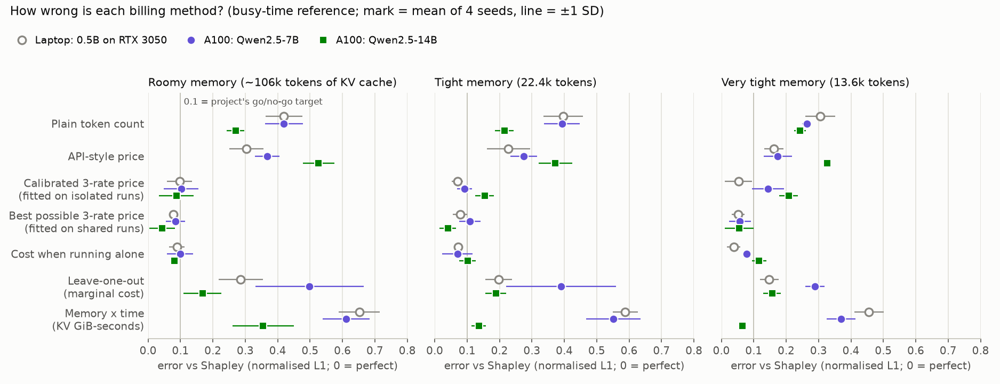
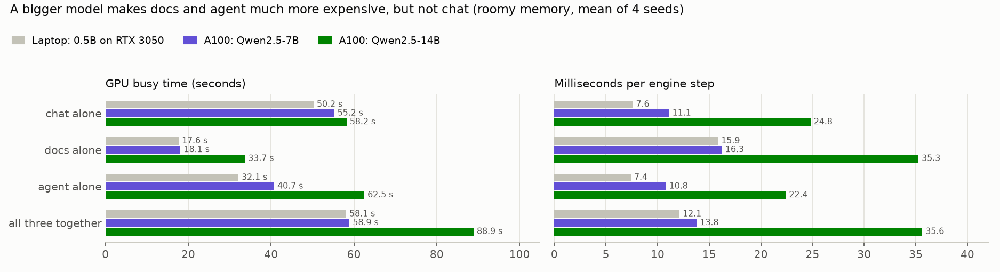
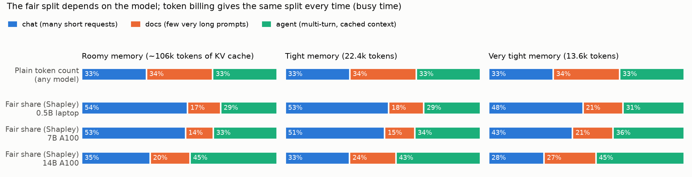
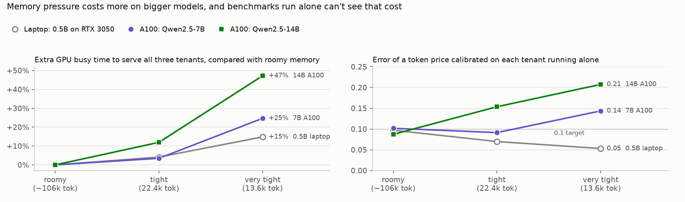
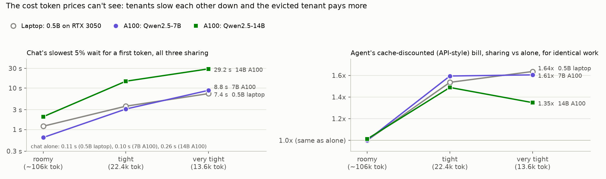

# FairShare: final results across three setups (laptop 0.5B, A100 7B, A100 14B)

*The final summary of the FairShare experiments, written 18 November 2026. It brings together the laptop proof-of-concept and the two cluster runs on JIIT's Ramanujan Universe (RU). Figures in `final_figures/` come from `poc/compare_models.py`, which also prints every number quoted here. The 7B run has its own detailed write-up in `qwen2.5-7b-instruct/experiment_summary.md`; this file doesn't repeat its detail.*

## In one paragraph

We measured how fairly token billing splits a shared GPU's cost among three tenants, using the exact Shapley value as the reference. The setups were a 0.5B model on a laptop GPU, and Qwen2.5-7B and Qwen2.5-14B on A100s, with the same workload and the same three memory settings each time. All 288 replays used in the analysis were measured cleanly. **Token billing puts 11–21% of the bill on the wrong tenant on every setup.** **The fair split itself changes with the model:** going from 7B to 14B, chat's fair share falls from 53% to 35% and the agent's rises from 33% to 45%. Every fixed formula (plain tokens, API-style ratios, memory × time) gives essentially the same split whatever the model, so none of them can be right on more than one model. **Prices calibrated on the actual model work when memory is plentiful (error about 0.1 or less on all setups).** **They break down under memory pressure, and more so on bigger models:** squeezing memory adds 15% to the cost of serving everyone on the laptop, 25% on 7B and 47% on 14B. Benchmarks run one tenant at a time never see that extra cost. **Tenants also harm each other:** on 14B, chat's slowest responses go from 0.26 s to 29 s, and the tenant whose cache gets evicted pays 35–49% more for the same work. **Re-analysing the existing replays points to the fix:** a token price fitted to measured Shapley values stays within about 0.1 in every setup and memory condition (worst 0.11). Every calibration from cost totals alone, with or without a memory term, still misses on 14B under memory pressure (about 0.15).

## 1. What we ran

| | Laptop PoC | Cluster run 1 | Cluster run 2 |
|---|---|---|---|
| Model | Qwen2.5-0.5B-Instruct, fp16 | Qwen2.5-7B-Instruct, bf16 | **Qwen2.5-14B-Instruct, bf16** |
| GPU | RTX 3050 Laptop, 4 GB | A100-SXM4 80 GB (RU `jiit-gpu01`) | A100-SXM4 80 GB (same node) |
| Weights / KV cache per token | ~1 GB / 12 KiB | ~15 GB / 56 KiB | ~29 GB / 192 KiB |
| Clean replays | 96 of 96 | 96 of 96 | 96 (8 flagged attempts discarded) |
| Dates | September 2026 | 15 November 2026 | 16–18 November 2026 |

**Identical in all three setups:**
- **Engine:** vLLM 0.30.0, prefix caching on, 8,192-token chunked prefill, block size 16.
- **Tenants:**
  - *chat:* about 127 short requests (256–1,024-token prompts).
  - *docs:* about 10 very long prompts (6–12k tokens).
  - *agent:* 4 sessions × 6 turns, with a growing, cached context.
  - Each tenant sends about 97–100k tokens per seed, inside a 60-second traffic window.
- **Replays:** all 7 tenant combinations ("coalitions") plus one repeat of the full set. That's 4 seeds × 3 memory levels = 96 runs per setup.
- **Memory levels (KV cache, in tokens):** roomy 105,632; tight 22,400; very tight 13,600. These are token capacities, so the same level holds the same number of tokens on every model, even though a 14B token takes 3.4 times as many bytes as a 7B token.
- **Costs measured:**
  - busy time: the sum of engine-step durations;
  - dynamic GPU energy: energy above idle, from the GPU's energy counter.

**The same request rates gave very different loads.** On 7B the A100 had spare capacity: all three tenants together kept it busy for 59 s of a 60 s window. On 14B the GPU couldn't keep up. All three together needed 89 s of GPU time for 60 s of traffic, so requests queued past the end of the window. The two cluster runs therefore cover a lightly loaded and a heavily loaded GPU. That was the main gap left by the 7B run.

## 2. Running on a shared cluster: how clean is the data?

RU's A100s are shared with other users, and PBS doesn't keep other users' jobs off the GPU it gives you. Every replay was therefore guarded:
- **Before:** the GPU had to be quiet for 3 seconds.
- **During:** every other process's compute share was sampled every 0.5 s.
- **After:** the GPU was re-checked.

A replay that failed any check was flagged, discarded and retried. After 8 flagged replays in a row, the job stopped itself.

- **7B: no other compute at all.** Every quiet-wait was 3 s, and no other process used the GPU's compute cores during any replay.
- **14B: a light neighbour was tolerated.**
  - During the 14B run, no RU GPU with enough free memory stayed fully idle, so the 14B gate was relaxed: another process could use up to 10% of the GPU on average, before, during and after each replay.
  - A diagnostic job checked first that this neighbour didn't matter. Five identical full-coalition replays next to it agreed within 0.54% on busy time and 0.81% on energy.
  - Roomy and very tight ran next to a neighbour averaging 1.3–4.5% (median 2.9%). Tight ran with no other compute at all.
  - The noise floor matches 7B. Repeating the full coalition changed the Shapley shares by at most 0.003, against 0.0034 on 7B. Busy time changed by a median of 0.56% (7B 0.19%).
- **The guard matters, with numbers.**
  - One 14B tight attempt landed next to a heavy neighbour using 20–38% of the GPU.
  - Docs alone took 78 s instead of the 35.5 s of the same seed's clean run, and all three tenants took 218 s instead of 102 s.
  - All 8 of those replays were flagged and discarded.
  - So a light neighbour is harmless, a heavy one would more than double the measured cost, and the monitor tells them apart.
- **GPUs used:** each memory level ran on a single physical GPU, but different levels didn't always share one. 7B roomy and tight ran on one A100 and very tight on a second. 14B roomy and very tight ran on a third, and tight on the same A100 as 7B very tight.

Jobs: 7B 15467, 15488, 15489; 14B 15751 (roomy), 15753 (very tight), 15956 (tight). Diagnostic and smoke runs were 15749 and 15750.

## 3. How to read the numbers

- **Shapley value (the reference).** The fair share of a cost that several tenants cause together. Imagine the tenants joining the server one at a time in every possible order. Each tenant's Shapley share is the average extra cost it adds when it joins. With 3 tenants this needs all 7 combinations replayed, which is what every run did.
- **Error (normalised L1).** The sum over tenants of |billing method's share − Shapley share|. **Half of it is the fraction of the bill charged to the wrong tenant**: an error of 0.42 means 21% of the bill is on the wrong tenant. **0.1 is the project's go/no-go target.**
- **Billing methods compared:**
  - *Plain token count:* everyone pays per token.
  - *API-style price:* output tokens cost 5×, cached input 0.1×.
  - *Calibrated 3-rate price:* three per-token prices fitted to each tenant's cost when running alone, on the other seeds. This is what an operator could do with benchmarks.
  - *Best possible 3-rate price:* the same three prices, fitted to the Shapley values measured on the other seeds. Like the calibrated price, it is tested on a held-out seed, so an operator could use it, but only by measuring Shapley values, which means replaying tenant combinations (section 5.6).
  - *Cost when running alone:* shares of standalone cost.
  - *Leave-one-out:* marginal cost.
  - *Memory × time:* KV-cache GiB-seconds.

  Full definitions are in the 7B write-up, section 2.
- **pp** = percentage points of the bill.

## 4. The results in one table

Error vs Shapley, busy-time reference, mean of 4 seeds: laptop 0.5B | A100 7B | **A100 14B**.

| Method | Roomy | Tight | Very tight |
|---|---|---|---|
| Plain token count | 0.42 \| 0.42 \| **0.27** | 0.40 \| 0.39 \| **0.22** | 0.31 \| 0.26 \| **0.24** |
| API-style price | 0.30 \| 0.37 \| **0.53** | 0.23 \| 0.28 \| **0.37** | 0.16 \| 0.17 \| **0.33** |
| Calibrated 3-rate price | 0.10 \| 0.10 \| **0.09** | 0.07 \| 0.09 \| **0.15** | 0.05 \| 0.14 \| **0.21** |
| Best possible 3-rate price | 0.08 \| 0.08 \| **0.04** | 0.08 \| 0.11 \| **0.04** | 0.05 \| 0.06 \| **0.06** |
| Cost when running alone | 0.09 \| 0.10 \| **0.08** | 0.07 \| 0.07 \| **0.10** | 0.04 \| 0.08 \| **0.12** |
| Leave-one-out | 0.29 \| 0.50 \| **0.17** | 0.20 \| 0.39 \| **0.19** | 0.15 \| 0.29 \| **0.16** |
| Memory × time | 0.65 \| 0.61 \| **0.36** | 0.59 \| 0.55 \| **0.14** | 0.46 \| 0.37 \| **0.07** |

With dynamic energy as the reference instead of busy time, every conclusion below holds. Figure `final_figures/3b_error_by_model_energy.png` and appendix B have the numbers.

## 5. Findings

### 5.1 Token billing is wrong on every setup, but who it over-charges depends on the model

- **Plain token billing is off by 0.22–0.42 on every setup and memory level**, so 11–21% of the bill goes to the wrong tenant. It never comes close to the 0.1 target. On 14B the error is smaller (0.22–0.27), but that's because the 14B's fair split happens to sit nearer to equal thirds, not because tokens track cost better there.
- **Docs is over-charged everywhere,** by 13–20 pp on the laptop and 7B and by 7–13 pp on 14B. That's the opposite of the proposal's motivating example, which assumed long documents look cheap under token billing.
- **The under-charged tenant changes with the model.** On the laptop and 7B, token billing under-charges chat by 10–21 pp. On 14B chat is roughly right, and the agent is under-charged by 10–12 pp.

### 5.2 The fair split depends on the model, so no fixed formula can be fair

Going from 7B to 14B, chat's busy time alone barely moves (55.2 → 58.2 s). Docs nearly doubles (18.1 → 33.7 s) and the agent rises by half (40.7 → 62.5 s).

- **Chat's cost is set by time, not computation.** Its 127 short requests are spread over the whole minute, so the engine keeps stepping for about the length of the traffic window whatever the model. On 14B each step takes twice as long (24.8 ms against 11.1 ms), but more requests share each step, so chat takes half as many steps (2,345 against 4,963). The total is about a minute either way.
- **Docs and agent are set by computation.** Processing long prompts and long contexts grows with model size, so their cost roughly doubles.

The fair split therefore moves with the model: at roomy memory, chat / docs / agent is 53 / 14 / 33% on 7B and 35 / 20 / 45% on 14B. Every fixed formula gives essentially the same split on every model, because the token traffic is the same:

- **Plain tokens** always give 33 / 34 / 33.
- **API-style prices** always give about 50 / 32 / 18 at roomy. That happens to suit chat on 7B, but on 14B it over-charges chat by 15 pp and under-charges the agent by 26 pp. **The API-style error gets worse on the bigger model: 0.37 → 0.53.** Fitted to each model's measurements, an output token costs 18 times an uncached input token on 7B but only 6 times on 14B. Input processing doubles in cost on the bigger model, and chat-style output doesn't. No single ratio fits both.
- **Memory × time** gives about 25 / 27 / 48 at tight and very tight memory on both models. It is the worst method on 7B (0.37–0.61) but scores 0.07 on 14B at very tight. Memory × time didn't get better. The 14B's fair split moved towards the split it gives. analysis.md §7 asked whether memory × time becomes a good proxy on bigger models. This says it's only right when the model happens to match it.

**Methods that use measurements from the actual model do much better.** The calibrated price, cost when running alone and the best possible price are all within about 0.1 at roomy memory on every setup (0.04–0.10).

### 5.3 Memory pressure adds a cost that grows with model size, and benchmarks run alone miss it

- **Squeezing memory makes serving everyone more expensive, and more so on bigger models.** From roomy to very tight, the full coalition's busy time grows 15% on the laptop, 25% on 7B and **47% on 14B (88.9 s → 130.8 s)**. Energy grows 18%, 22% and **45%**.
  - The extra cost comes from preemptions (about 10–13 per full-coalition run at very tight) and from recomputing evicted cache.
  - Sharing also saves less: serving all three together costs 77% of serving them separately on 14B at very tight, against 58% at roomy.
- **The calibrated price's error follows that extra cost on the A100s.**
  - 7B: 0.10 / 0.09 / 0.14.
  - 14B: 0.09 / **0.15** / **0.21**, above the target at both tight levels.
  - A tenant running alone barely experiences memory pressure, so standalone benchmarks have nothing to learn this cost from.
- **The fault is in the calibration data, not the price form.** The same 3-rate price fitted on *shared* runs stays at 0.04–0.06 on 14B at every memory level. Token counts from shared runs do carry the cost signal.
- **The laptop is the exception.** Its calibrated price improves under pressure (0.10 → 0.05) despite the 15% extra cost. The pattern holds on both A100 runs, but it is still an explanation the data supports, not a proven mechanism.
- **The inverted cached price is not the cause.** Forcing the fitted cached-token price at or below the uncached one makes 14B much worse (0.09 → 0.26 at roomy), as it did on 7B at roomy and tight. Only the agent has cached tokens, so that rate absorbs the agent's other costs and isn't a physical price.

### 5.4 Tenants harm each other, and the evicted tenant pays

No per-token price can represent these costs, because they depend on who else is running.

- **Chat's tail latency.** On 14B, chat's slowest 5% of requests wait 0.26 s for their first token when chat runs alone. With all three sharing, that grows to 2.0 s at roomy, 14.7 s at tight and **29.2 s** at very tight, a 112-fold slowdown. On 7B it was 0.64 / 3.1 / 8.8 s, from 0.10 s alone.
- **The agent's lost cache.** On 14B, when alone, the agent reuses 77% of its prompt tokens from cache (54% at very tight). Sharing pushes that down to 36% at tight and 13% at very tight, so the GPU recomputes the evicted context.
- **The victim pays.** Under cache-discounted (API-style) pricing, the agent's bill for identical work rises 1.49× at tight and 1.35× at very tight on 14B. It rose 1.59× and 1.61× on 7B, and 1.54× and 1.64× on the laptop. The tenants who caused the evictions pay nothing extra.
  - The 14B very-tight multiplier is lower only because the agent already loses much of its cache when alone there (54% hit rate, against 70% on 7B).
  - This effect appears on all three setups, so it doesn't depend on model size or hardware.

### 5.5 Under heavy load, sharing is less free and leave-one-out improves

- **On 7B, adding a tenant was nearly free.** The GPU had spare capacity: serving all three cost 52–62% of serving them separately. That made marginal-cost (leave-one-out) billing wrong by 0.29–0.50 and noisy across seeds.
- **On 14B the GPU is overloaded.** Costs add up more: serving all three costs 58–77% of serving them separately. Leave-one-out improves to 0.16–0.19.
- **The main conclusions hold under heavy load.** That answers the 7B run's biggest caveat (it only covered a lightly loaded GPU). Tokens and API-style prices are still wrong, calibrated prices are still fine at roomy memory, and interference is still the strongest effect.

### 5.6 Can an operator fix the calibration? Only by measuring Shapley values

The existing replays already contain every tenant combination, so `calibration_check.py` re-fits the 3-rate price in several ways without new GPU time. As before, each price is fitted on three seeds and tested on the fourth.

The calibration sources:
- **solo runs:** each tenant alone. This is the calibrated price from section 4.
- **pairs:** the three two-tenant runs, fitting each run's total cost to its total tokens.
- **all combinations:** every tenant combination, fitted the same way.
- **a memory term:** a fourth price per KV-cache GiB-second the tenant held.
- **measured Shapley values:** fitting to Shapley values instead of cost totals (the "best possible" price).

Each row summarises the 9 cells (3 setups × 3 memory levels).

| Calibration | Busy time: mean error / worst cell / cells above 0.1 | Energy: mean / worst / above 0.1 |
|---|---|---|
| Each tenant alone (today's calibrated price) | 0.112 / 0.208 (14B very tight) / 4 | 0.100 / 0.171 / 3 |
| Pairs of tenants only | 0.230 / 0.319 / 9 | 0.205 / 0.275 / 8 |
| All tenant combinations | 0.093 / 0.151 (14B very tight) / 4 | 0.075 / 0.115 / 3 |
| Alone, plus a memory-time term | 0.103 / 0.154 (14B tight) / 5 | 0.092 / 0.126 / 3 |
| **Measured Shapley values from the other seeds** | **0.066 / 0.109 (7B tight) / 1** | **0.059 / 0.088 / 0** |

What this shows:
- **Fitting to cost totals isn't enough.** Calibrating on all tenant combinations improves the average and fixes 7B very tight (0.14 → 0.07) and 14B tight (0.15 → 0.07). 14B very tight still stays at 0.15.
- **Pairs alone are worse than useless (0.23).** A pair's total cost can't tell which tenant's tokens caused it.
- **The memory-time term helps exactly where memory pressure is worst** (14B very tight: 0.21 → 0.12), but it hurts elsewhere (7B tight: 0.09 → 0.14). On balance it isn't a fix.
- **A token price fitted to measured Shapley values works everywhere.** The worst cell is 0.11 on busy time; on energy every cell is within 0.09. Its prices differ by model and memory level, as section 5.2 says they must.

So a token price can be fair, but only if it is periodically recalibrated against Shapley values measured on the same model under the same memory conditions. That measurement is exactly what FairShareAI's replay-based attribution provides.

The held-out seeds use the same three tenants and the same traffic mix, so whether these prices carry over to a different mix of tenants is untested.

## 6. What we expected, and what we found

| # | Expectation before the 14B run (source) | What the 14B run showed |
|---|---|---|
| 1 | The token-billing error replicates on a second model size (7B write-up §7, item 2). | **Yes:** 0.27 / 0.22 / 0.24, still far above 0.1. The under-charged tenant switched from chat to the agent. |
| 2 | The 7B A100 was lightly loaded; near full load "costs become more additive and the picture could change" (7B caveat 1). | **More additive, as predicted:** all three cost 58–77% of the separate total, and leave-one-out improves. The main conclusions don't change. |
| 3 | The calibrated price slips under memory pressure because of a cost that only exists when tenants share (7B write-up §4.5). | **Stronger evidence:** on 14B memory pressure adds 47%, the calibrated price reaches 0.21, and the best possible price stays at 0.06. |
| 4 | Memory × time might become a good proxy on bigger models (analysis.md §7, finding 4). | **Only by coincidence:** 0.07 on 14B at very tight, but 0.37 on 7B with almost the same split. |
| 5 | Calibrating on pairs of tenants, or adding a memory term to the price, would fix the slip under memory pressure (7B write-up §4.5). | **Only partly** (section 5.6). Pairs alone are worse. All combinations and the memory term each fix some cells but not 14B very tight. Fitting to measured Shapley values fixes all of them. |
| 6 | *Not predicted.* | **API-style prices get worse on the bigger model** (0.37 → 0.53 at roomy), and the fair split itself moves with the model. |

## 7. Relation to recent work

From a literature check on 15 November 2026, worth repeating once before the report is submitted.

| Work | What it covers | How FairShare differs |
|---|---|---|
| **JouleShare** | Shapley attribution of GPU energy across tenants; the source of the normalised L1 metric, with token billing at about 0.45 on energy | Our token-billing errors on energy are 0.13–0.41. FairShare adds busy time, memory pressure and three setups. |
| **StepSplit** (arXiv 2611.13802), from the same group as JouleShare | A closed-form "step-sharing" Shapley value with about 1% error, on the same Qwen2.5-7B and vLLM 0.30 | They approximate Shapley cheaply. We replay every coalition exactly. Our central new result, the cost of memory pressure and eviction, isn't part of their evaluation as far as we could tell. |
| **unalloc** (arXiv 2609.24991) | Tenant-level token vs time-share meters on an H100, with a 12–14 pp gap, plus a financial ledger | A similar size of gap (our 11–21% mis-billed). We add the Shapley reference, memory pressure and model-size dependence. |
| **Bursts** (arXiv 2611.13412) | Prefix-cache collapse under bursty agent traffic | Related to our agent cache-loss result, but about stability, not billing. |

**What, as far as that check found, is new in FairShare:**
1. Attribution under KV-cache memory pressure. The sharing-only cost grows with model size (+15 / +25 / +47%), and solo-calibrated prices fail because of it.
2. The victim-pays effect, measured: the evicted tenant pays 35–64% more for identical work.
3. The fair split moving with model size, so that no fixed token formula can be fair across models.
4. Exact tenant-level Shapley, with every coalition replayed on a real engine, at three model sizes.
5. A recipe that works: token prices fitted to measured Shapley values stay within about 0.1 in every condition we measured, while benchmark-calibrated prices don't (section 5.6).

analysis.md §5 ("what is left that is new") predates the last three papers and should be updated with this table.

## 8. Caveats

1. **Shared cluster.** The 14B roomy and very-tight replays ran next to a light neighbour (≤ 4.5% average compute). Section 2 gives the evidence that it didn't matter, but this is not an exclusive GPU. CPU load from other users on the node wasn't controlled; it is recorded per run as `loadavg_1m`.
2. **Several physical GPUs.** Each memory level ran on one GPU, but levels were spread over three A100s (section 2). Comparisons between levels partly compare GPUs:
   - the 7B roomy → very tight change (+25%) spans two GPUs;
   - the 14B roomy → very tight change (+47%) is on a single GPU.
3. **Load wasn't controlled.** The same request rates were used for every model, so 7B was lightly loaded and 14B heavily loaded. The two runs cover both regimes, but this is not a controlled load sweep.
4. **Synthetic workload.** Prompts are random token IDs, output lengths are forced, and every tenant has the same token volume. That is good for controlled comparison but isn't real traffic.
5. **4 seeds per setup.** Leave-one-out in particular varies across seeds.
6. **Busy time counts time the engine is stepping, however full the batch.** Dynamic energy is the second reference for that reason, and it gives the same conclusions.
7. **The cached-token price can't be identified,** because only the agent has cached tokens (section 5.3).
8. **One engine setting differs from the laptop.** vLLM's FlashInfer sampler was off on RU, because the GPU node can't compile it. Replays decode greedily, so the sampler isn't part of what is measured.

## 9. What this means for FairShareAI

1. **Token billing misallocates shared-GPU cost.** This holds from a 0.5B laptop model to a 14B model on a datacenter GPU, with 11–21% of the bill on the wrong tenant. The motivation section should use this evidence, including the direction: long documents are over-charged, not under-charged.
2. **Any price has to be measured on the model it bills for.** The fair split moves with the model, so fixed ratios (tokens, API-style, memory × time) can be right on at most one model. This is the strongest argument for a measurement-based attribution engine, which is FairShareAI's core idea.
3. **Calibrate against measured Shapley values, not benchmarks.** Standalone benchmarks miss the cost of memory pressure, which reaches 47% on 14B. Fitting to cost totals from tenant combinations doesn't fully recover it either. A token price fitted to measured Shapley values stays within about 0.1 everywhere (section 5.6). That suggests a practical design for FairShareAI: measure Shapley values periodically by replaying tenant combinations, and bill per token in between, with prices that are specific to the model and the memory condition.
4. **Interference is the clearest and most stable result.** Tail latency rose up to 112-fold, and the evicted tenant paid 35–64% more, on every setup. Pricing needs to charge whoever causes the eviction. Scheduling is the lever that reduces the harm, as analysis.md §9 argued.

## 10. Suggested next steps

1. **Test whether Shapley-calibrated prices carry over to a new tenant mix.** For example: calibrate with three tenants and bill a mix with one dropped, or with different request rates. Section 5.6 only tests new seeds of the same mix. This is the main open question for the design in section 9.
2. **A controlled load sweep:** the same tenants at increasing request rates on one model, to separate the effect of load from the effect of model size.
3. **Real traces and more seeds,** if time allows before the report.

## 11. Files and how to regenerate

| File | What it is |
|---|---|
| `final_summary.md` | This summary |
| `final_figures/` | Generated by `python compare_models.py` (run from `poc/`), which also prints every number quoted here |
| (no file) | `python calibration_check.py` (run from `poc/`) prints the section 5.6 table |
| `qwen2.5-14b-instruct/runs.jsonl` | 14B raw data: 96 clean replays plus 8 flagged attempts (ignored by the analysis) |
| `qwen2.5-14b-instruct/summary.md`, `summary.json`, `figures/` | Generated by `python analyze.py --runs results/qwen2.5-14b-instruct/runs.jsonl` |
| `qwen2.5-14b-instruct/tight_other_gpu.jsonl` | 10 discarded tight attempts from a GPU none of the other levels used (2 clean, 8 flagged); kept for the record, not analysed |
| `qwen2.5-7b-instruct/` | The 7B run: data, its own write-up, and `compare_7b.py` figures |
| `runs.jsonl`, `summary.md` | The laptop PoC |

The laptop has no vLLM environment any more. The analysis scripts only need numpy, scipy and matplotlib: `uv run --no-project --with numpy --with scipy --with matplotlib python compare_models.py`.

## Appendix: the numbers behind the figures

**A. Error vs Shapley, busy-time reference (mean ± SD over 4 seeds), laptop | 7B | 14B**

| Method | Roomy | Tight | Very tight |
|---|---|---|---|
| Plain token count | 0.42 ± 0.06 \| 0.42 ± 0.06 \| 0.27 ± 0.03 | 0.40 ± 0.06 \| 0.39 ± 0.06 \| 0.22 ± 0.03 | 0.31 ± 0.05 \| 0.26 ± 0.01 \| 0.24 ± 0.02 |
| API-style price | 0.30 ± 0.05 \| 0.37 ± 0.04 \| 0.53 ± 0.05 | 0.23 ± 0.07 \| 0.28 ± 0.04 \| 0.37 ± 0.05 | 0.16 ± 0.03 \| 0.17 ± 0.04 \| 0.33 ± 0.01 |
| Calibrated 3-rate price | 0.10 ± 0.04 \| 0.10 ± 0.05 \| 0.09 ± 0.05 | 0.07 ± 0.02 \| 0.09 ± 0.02 \| 0.15 ± 0.03 | 0.05 ± 0.04 \| 0.14 ± 0.05 \| 0.21 ± 0.03 |
| Best possible 3-rate price | 0.08 ± 0.01 \| 0.08 ± 0.03 \| 0.04 ± 0.04 | 0.08 ± 0.02 \| 0.11 ± 0.03 \| 0.04 ± 0.03 | 0.05 ± 0.02 \| 0.06 ± 0.03 \| 0.06 ± 0.05 |
| Cost when running alone | 0.09 ± 0.02 \| 0.10 ± 0.04 \| 0.08 ± 0.01 | 0.07 ± 0.01 \| 0.07 ± 0.05 \| 0.10 ± 0.03 | 0.04 ± 0.02 \| 0.08 ± 0.01 \| 0.12 ± 0.02 |
| Leave-one-out | 0.29 ± 0.07 \| 0.50 ± 0.17 \| 0.17 ± 0.06 | 0.20 ± 0.04 \| 0.39 ± 0.17 \| 0.19 ± 0.03 | 0.15 ± 0.03 \| 0.29 ± 0.03 \| 0.16 ± 0.03 |
| Memory × time (KV GiB·s) | 0.65 ± 0.06 \| 0.61 ± 0.07 \| 0.36 ± 0.09 | 0.59 ± 0.04 \| 0.55 ± 0.08 \| 0.14 ± 0.02 | 0.46 ± 0.05 \| 0.37 ± 0.04 \| 0.07 ± 0.01 |
| Noise floor (largest, repeat run) | 0.001 \| 0.003 \| 0.003 | | |

**B. Error vs Shapley, dynamic-energy reference (roomy / tight / very tight)**

| Method | Laptop | 7B | 14B |
|---|---|---|---|
| Plain token count | 0.41 / 0.38 / 0.29 | 0.36 / 0.31 / 0.21 | 0.16 / 0.13 / 0.19 |
| API-style price | 0.31 / 0.23 / 0.15 | 0.28 / 0.17 / 0.13 | 0.42 / 0.29 / 0.29 |
| Calibrated 3-rate price | 0.10 / 0.08 / 0.06 | 0.10 / 0.07 / 0.14 | 0.07 / 0.13 / 0.17 |
| Best possible 3-rate price | 0.09 / 0.08 / 0.05 | 0.08 / 0.08 / 0.03 | 0.05 / 0.03 / 0.05 |
| Cost when running alone | 0.08 / 0.07 / 0.04 | 0.08 / 0.07 / 0.10 | 0.06 / 0.10 / 0.11 |
| Leave-one-out | 0.35 / 0.24 / 0.17 | 0.40 / 0.28 / 0.26 | 0.15 / 0.17 / 0.15 |
| Memory × time | 0.63 / 0.57 / 0.43 | 0.57 / 0.50 / 0.35 | 0.25 / 0.13 / 0.11 |

**C. Each tenant's share of the bill, chat / docs / agent (%), busy time**

| | Roomy | Tight | Very tight |
|---|---|---|---|
| Plain token count (any model) | 33 / 34 / 33 | 33 / 34 / 33 | 33 / 34 / 33 |
| Shapley, laptop 0.5B | 54 / 17 / 29 | 53 / 18 / 29 | 48 / 21 / 31 |
| Shapley, 7B | 53 / 14 / 33 | 51 / 15 / 34 | 43 / 21 / 36 |
| Shapley, 14B | 35 / 20 / 45 | 33 / 24 / 43 | 28 / 26 / 45 |
| API-style price, 14B | 50 / 32 / 18 | 46 / 30 / 25 | 43 / 28 / 29 |
| Calibrated price, 14B | 38 / 22 / 40 | 40 / 24 / 36 | 38 / 27 / 35 |

**D. Memory pressure and interference, all three tenants sharing (laptop | 7B | 14B)**

| Metric | Roomy | Tight | Very tight |
|---|---|---|---|
| Busy time | 58.1 \| 58.9 \| 88.9 s | 60.5 \| 61.0 \| 99.5 s | 66.7 \| 73.5 \| 130.8 s |
| Extra busy time vs roomy | | +4 \| +3 \| +12% | +15 \| +25 \| +47% |
| Extra dynamic energy vs roomy | | +5 \| +6 \| +17% | +18 \| +22 \| +45% |
| Preemptions per run | 0 \| 0 \| 0 | 5.5 \| 3.0 \| 8.5 | 9.8 \| 11.5 \| 13.2 |
| All three ÷ sum of each alone (busy time) | 0.58 \| 0.52 \| 0.58 | 0.61 \| 0.53 \| 0.65 | 0.66 \| 0.62 \| 0.77 |
| Chat p95 time to first token (alone: 0.11 \| 0.10 \| 0.26 s) | 1.20 \| 0.64 \| 2.04 s | 3.66 \| 3.12 \| 14.67 s | 7.37 \| 8.84 \| 29.16 s |
| Agent cache-hit rate (alone at very tight: 73 \| 70 \| 54%) | 77 \| 77 \| 76% | 41 \| 38 \| 36% | 23 \| 19 \| 13% |
| Agent's API-style bill vs alone | 1.00 \| 1.00 \| 1.01× | 1.54 \| 1.59 \| 1.49× | 1.64 \| 1.61 \| 1.35× |

**E. Roomy memory, mean of 4 seeds: busy time / engine steps / ms per step (laptop | 7B | 14B)**

| | Laptop | 7B | 14B |
|---|---|---|---|
| chat alone | 50.2 s / 6,600 / 7.6 | 55.2 s / 4,963 / 11.1 | 58.2 s / 2,345 / 24.8 |
| docs alone | 17.6 s / 1,113 / 15.9 | 18.1 s / 1,114 / 16.3 | 33.7 s / 954 / 35.3 |
| agent alone | 32.1 s / 4,320 / 7.4 | 40.7 s / 3,762 / 10.8 | 62.5 s / 2,787 / 22.4 |
| all three together | 58.1 s / 4,790 / 12.1 | 58.9 s / 4,270 / 13.8 | 88.9 s / 2,494 / 35.6 |

Fitted calibrated prices put an output token at 16.0 / 15.6 / 14.1 (laptop), 18.0 / 17.0 / 14.6 (7B) and 6.4 / 6.0 / 4.1 (14B) times an uncached input token.
