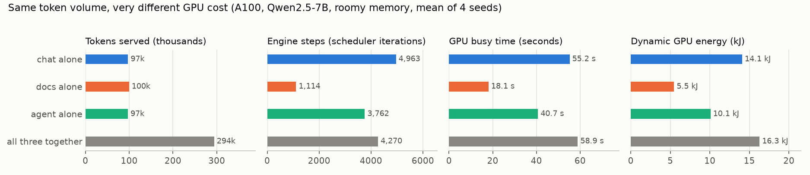
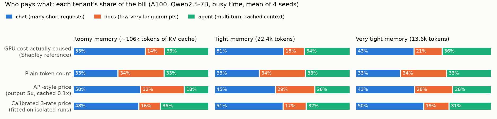
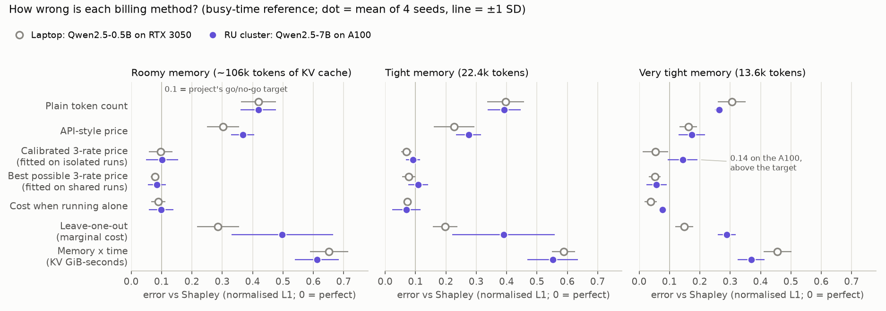
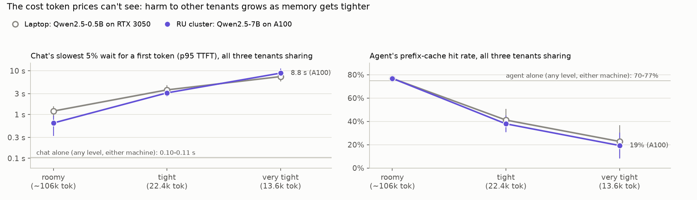

# FairShare cluster run: Qwen2.5-7B on an A100 (RU, 15 November 2026)

*A human-written summary of the cluster experiment. `summary.md` in this folder is the machine-generated table dump from `analyze.py` (it is overwritten on every run); this file explains what the numbers mean. Figures in `report_figures/` come from `poc/compare_7b.py`, which also prints every number quoted here.*

## In one paragraph

We repeated the laptop proof-of-concept on a model 14 times larger (Qwen2.5-7B instead of 0.5B) and a datacenter GPU (an A100 80 GB on JIIT's Ramanujan Universe cluster instead of an RTX 3050 laptop GPU), with the same three tenants, the same workload and the same three memory settings. All 96 replays were measured cleanly. **The main finding replicates almost exactly:** charging by token count puts about a fifth of the GPU bill on the wrong tenant, it over-charges the long-document tenant and under-charges the short-request tenant, the opposite of what the original proposal assumed. **A token price calibrated from benchmarks still fixes most of that error, except under very tight memory,** where it slips above the project's 0.1 target. **The harm tenants do to each other** (slower responses, lost cache) **replicates and is the strongest result.** The A100 also shares work between tenants more efficiently than the laptop, which makes "marginal cost" billing about twice as wrong.

## 1. What we ran

| | Laptop PoC | Cluster run (this folder) |
|---|---|---|
| Model | Qwen2.5-0.5B-Instruct, fp16 | **Qwen2.5-7B-Instruct, bf16** |
| GPU | RTX 3050 Laptop, 4 GB | **A100-SXM4 80 GB** on RU node `jiit-gpu01` (shared with other users) |
| Engine | vLLM 0.30.0, prefix caching on, 8,192-token chunked prefill, block size 16 | same (vLLM 0.30.0+cu129) |
| Tenants | chat: ~127 short requests (256–1,024-token prompts); docs: ~10 very long prompts (6–12k tokens); agent: 4 sessions × 6 turns with a growing, cached context. About 97–100k tokens each per seed. | same |
| Replays | all 7 tenant combinations ("coalitions") + one repeat of the full set, 4 seeds × 3 memory levels = 96 runs | same, **96 of 96 clean** |
| Memory levels (KV cache) | roomy 6,602 blocks = 105,632 tokens; tight 22,400 tokens; very tight 13,600 tokens (about 1.1 × the largest request) | same token capacities |
| Cost measured | busy time (sum of engine-step durations) and dynamic GPU energy | same |

**How clean is the cluster data?** The A100 is shared with other RU users, so every replay was guarded. Before each replay, the GPU had to show 0% utilisation for 3 seconds. During it, other processes' compute use was sampled every 0.5 s, and utilisation was re-checked afterwards. All 96 replays passed on the first attempt: every quiet-wait was 3 s, and no other process used the GPU's compute cores during any replay. Other users' idle programs did hold memory on the GPU (1 process with 0.4 GB during very tight, 3 processes with 51 GB during tight and roomy), but they never computed. The driver supported per-process monitoring throughout. The GPU clock was fixed at 1,140 MHz and the temperature stayed at 23–30 °C, so the hardware conditions were steadier than on the laptop (66–73 °C with shifting clocks). Repeating the full coalition changed the result by at most 0.002, which is the noise floor.

Jobs: 15467 (very tight), 15488 (tight), 15489 (roomy), about 40 minutes each once an idle GPU was available.

## 2. How to read the numbers

- **Shapley value (the reference).** The fair share of a cost that several tenants cause together. Imagine the tenants joining the server one at a time in every possible order. Each tenant's Shapley share is the average extra cost it adds when it joins. With 3 tenants this needs all 7 combinations replayed, which is what the experiment does.
- **Error (normalised L1).** The sum over tenants of |billing method's share − Shapley share|. 0 means identical. **Half of it is the fraction of the bill charged to the wrong tenant**: an error of 0.42 means 21% of the bill is on the wrong tenant. This is the metric JouleShare used.
- **Billing methods compared.** *Plain token count*: everyone pays per token. *API-style price*: output tokens 5×, cached input 0.1×, the ratios commercial APIs use. *Calibrated 3-rate price*: three per-token prices (uncached input, cached input, output) fitted to each tenant's cost when running alone, on the other seeds; this is what an operator could do with benchmarks. *Best possible 3-rate price*: fitted directly to the Shapley values from shared runs; this is the ceiling for any token price. *Cost when running alone*: shares of standalone cost. *Leave-one-out*: what the bill drops by if a tenant leaves (marginal cost). *Memory × time*: KV-cache GiB-seconds.
- **pp** = percentage points of the bill.

## 3. What we expected, and what we found

| # | What we expected before the cluster run (source) | What the A100 run showed |
|---|---|---|
| 1 | The proposal claims long-document workloads "appear inexpensive under token-only accounting". The laptop showed the opposite; analysis.md §8 asked whether memory pressure on a bigger model would flip it. | **No flip.** Token billing over-charges docs by 13–20 pp and under-charges chat by 10–20 pp at every memory level, as on the laptop. |
| 2 | Plain token billing is substantially wrong (laptop 0.42 / 0.40 / 0.31; JouleShare about 0.45 on energy). | **Replicated almost exactly:** 0.42 / 0.39 / 0.26 (roomy / tight / very tight). |
| 3 | API-style ratios (output 5 × input) fix part of it. | **Only part:** 0.37 / 0.28 / 0.17, worse than the laptop at roomy. The measured output-to-input cost ratio is 15–18 : 1, not 5 : 1, and the 90% discount for cached tokens under-charges the agent by 15 pp at roomy. |
| 4 | The go/no-go question (analysis.md §9): does a calibrated 3-rate price stay within about 0.1 on a larger model? | **Yes, except under very tight memory:** 0.10 / 0.09 / **0.14**. On the laptop it was 0.10 / 0.07 / 0.05. |
| 5 | Charging by memory held (KV GiB·s) was the worst method on the laptop; maybe it becomes a good proxy on bigger models (analysis.md §7, finding 4). | **Still the worst:** 0.61 / 0.55 / 0.37. |
| 6 | Tenants harm each other more as memory gets tighter (laptop finding 5). | **Replicated.** Chat's slowest-5% wait for a first token goes from 0.10 s alone to 0.64 / 3.1 / 8.8 s with everyone sharing. The agent's cache-hit rate falls from 77% to 77 / 38 / 19%, and its cache-discounted bill rises 1.00 / 1.59 / 1.61× for identical work. |
| 7 | *Not predicted.* | **The A100 shares work more efficiently.** Serving all three together costs 52–62% of serving them separately (laptop 58–66%), and leave-one-out billing is about twice as wrong (0.50 / 0.39 / 0.29 against 0.29 / 0.20 / 0.15). |
| 8 | *My guesses during the run, both wrong:* (a) after seeing only very tight: "calibrated prices don't carry over to the A100"; (b) "the very-tight slip comes from the fitted cached-token price being higher than the uncached one". | (a) Wrong: they carry over at roomy and tight. (b) Tested by forcing cached ≤ uncached: very tight improves only from 0.144 to 0.129, and roomy and tight get worse (0.10 → 0.13, 0.09 → 0.13). So that is not the main cause. Section 4.5 gives the explanation the data supports. |

## 4. Findings

### 4.1 GPU cost follows engine steps, not tokens

This one figure explains most of the results. Each tenant sends about 100,000 tokens, yet chat alone keeps the GPU busy for 55 s and docs for only 18 s.

- **Why.** vLLM works in *steps*. In each step, every running request gets one more output token, and long prompts are processed up to 8,192 tokens at a time. For a 7B model, a step costs roughly 11 ms almost regardless of how many requests it carries, because generating a token means reading all ~15 GB of weights from memory.
- **Chat** spreads 127 short requests over the whole minute, so the engine steps continuously: 4,963 steps.
- **Docs** puts most of its tokens into long prompts that are processed thousands of tokens per step: only 1,114 steps.
- **Together**, the three tenants take *fewer* steps (4,270) than chat alone, because chat's tokens ride along in steps that are happening anyway. Adding docs and agent (another 200,000 tokens) to chat adds only 3.7 s of busy time.
- **Energy** shows the same pattern (14.1 kJ for chat, 5.5 kJ for docs, 16.3 kJ for all three), so this isn't an artefact of measuring time.

Token counts can't see steps. That is why token billing under-charges chat and over-charges docs, why output tokens cost 15–18 times as much as input tokens, and why sharing is so cheap.

### 4.2 Who pays what

Plain token billing splits the bill a third each, because the tokens are a third each. The cost each tenant actually causes is very different: at roomy memory, chat causes 53% and docs only 14%. As memory gets tighter, docs' share rises (14% → 21%) and chat's falls (53% → 43%), because now the memory docs occupy starts to slow the others down. Even then, docs is still over-charged by token billing.

The API-style price gets chat roughly right but swaps the error to the other two: it still over-charges docs (32% instead of 14% at roomy), and its 90% cached-token discount under-charges the agent (18% instead of 33%). The calibrated 3-rate price is within a few points at roomy and tight. At very tight it over-charges chat (50% instead of 43%).

### 4.3 How wrong each method is, laptop against A100

- **The ranking of methods is the same on both machines.** Memory × time is worst, then plain tokens and leave-one-out, then API-style prices. Calibrated prices, the best possible token price and standalone cost are all close to 0.1 or below.
- **Plain tokens:** almost identical on both machines.
- **Calibrated price:** the same as the laptop at roomy and tight, but it crosses the 0.1 target under very tight memory (0.14 against 0.05).
- **Leave-one-out:** about twice as wrong on the A100, and noisy across seeds (±0.17 at roomy and tight). When adding a tenant is nearly free (section 4.1), marginal cost says little about who caused the bill.
- **Energy as the reference:** the conclusions don't change. On the A100, plain tokens score 0.36 / 0.31 / 0.21, the calibrated price 0.10 / 0.07 / 0.14 and memory × time 0.57 / 0.50 / 0.35.

### 4.4 The cost token prices can't see: tenants harm each other

These are costs no per-token price can represent, because they depend on *who else is running*:

- **Chat's tail latency.** Alone, chat's slowest 5% of requests wait about 0.1 s for their first token. Sharing with docs and agent pushes that to 0.64 s at roomy, 3.1 s at tight and **8.8 s** at very tight, an 85-fold slowdown. At roomy and tight, docs' long prompts cause most of it. Under very tight memory the combination is far worse than either pair: 2.6 s with docs only, 1.5 s with agent only, 8.8 s with both (see `figures/chat_ttft.png`). At roomy memory the A100 suffers about half as much as the laptop (0.64 s against 1.2 s), but under very tight memory it is slightly worse (8.8 s against 7.4 s).
- **The agent's lost cache.** Alone, about 77% of the agent's prompt tokens are reused from its own cache. Under tight memory, the other tenants' requests push its cached context out of memory, and the hit rate falls to 38% (tight) and 19% (very tight), so the GPU must recompute that context.
- **The victim pays.** Under cache-discounted pricing (the realistic commercial baseline), the agent's bill rises 59–61% for exactly the same work, while the tenants who caused the evictions pay nothing extra (see `figures/agent_bill.png`).

These numbers are close to the laptop's (agent bill 1.54 / 1.64×, hit rate 41 / 23%), so this effect doesn't depend on model size or hardware.

### 4.5 Why the calibrated price slips under very tight memory

- **Memory pressure adds a cost that only exists when tenants share.** On the A100, the full coalition's busy time grows by 25% from roomy to very tight (58.9 s → 73.5 s), from 11.5 preemptions per run and the agent recomputing evicted context. On the laptop the same change added only 15% (58.1 s → 66.7 s).
- **Benchmarks run alone can't see it.** A tenant running alone barely experiences this pressure, so a price calibrated from standalone benchmarks has nothing to learn it from. The larger that cost is, the more the price misses.
- **The fault is the calibration data, not the price form.** A 3-rate price fitted on *shared* runs still reaches 0.06 at very tight. Token counts from shared runs do carry the cost signal.
- **The inverted cached price is not the main cause.** Forcing cached ≤ uncached barely helps (section 3, row 8).

This is the most likely explanation, not a proven one. Two ways to test it: calibrate on pairs of tenants as well as single tenants, or add a per-preemption charge to the price.

## 5. Caveats

1. **The A100 was lightly loaded.** The request rates were tuned for the laptop GPU. On the A100, adding 200,000 tokens of work to chat added only 3.7 s of busy time, so the GPU had a lot of spare capacity. Near full load, costs become more additive and the picture could change. plan.md §17 says load should be set relative to each model's measured capacity; this run didn't do that.
2. **One model size, one GPU type, 4 seeds.** Leave-one-out in particular varies a lot across seeds.
3. **Synthetic workload.** Prompts are random token IDs, output lengths are forced, and every tenant has the same token volume. That is good for controlled comparison but isn't real traffic.
4. **Shared cluster.** GPU contamination was detected, not prevented. The GPU-level checks were all clean, but CPU load from other users on the same node wasn't controlled (it is recorded per run as `loadavg_1m`).
5. **Two physical GPUs.** Very tight ran on one A100 and tight and roomy on another. Both are the same model, with the same fixed clock and no other compute during the runs.
6. **One engine setting differs from the laptop.** vLLM's FlashInfer sampler was turned off because RU's GPU node can't compile it. Replays use greedy decoding, so the sampler isn't part of what is measured.
7. **Busy time counts time the engine is stepping, however full the batch.** Dynamic energy is the second reference for that reason, and it gives the same conclusions.
8. **The cached-token price can't be identified.** Only the agent has cached tokens, so the fitted "cached" rate absorbs the agent's other costs (it comes out 1.9–2.2× the uncached rate). Don't read it as a physical price.

## 6. What this means for FairShareAI

1. **Token billing misallocates shared-GPU cost.** This now holds across a 14× change in model size and a change from laptop to datacenter GPU. The direction (long prompts over-charged, short interactive requests under-charged) is the opposite of the proposal's motivating example, so the motivation section should be rewritten around this evidence.
2. **A calibrated token price is good enough when memory is plentiful (≤ 0.1), but not under heavy memory pressure.** A measurement-based attribution engine earns its place in exactly the conditions where tenants interfere.
3. **Interference is the strongest and most stable result:** tail-latency inflation of up to 85× and the agent paying 60% more for lost cache. This supports the reframing in analysis.md §9: focus the project on measuring and pricing interference, with scheduling as the lever that reduces it.

## 7. Suggested next experiments

1. **Scale the load to the A100's capacity** by running the same tenants with more requests per second, up to and past the point where the GPU saturates. This is the biggest gap in the current evidence (caveat 1).
2. **A second model size:** Qwen2.5-14B in bf16, when RU has an idle GPU with about 36–52 GB free. 14B is also the largest model JouleShare tested.
3. **Test the explanation in 4.5:** calibrate on pairs of tenants, or add a preemption term, and check whether very tight drops back below 0.1.
4. **More seeds** if leave-one-out is going to be discussed in the report.

## 8. Files and how to regenerate

| File | What it is |
|---|---|
| `runs.jsonl` | Raw data: one line per replay with per-request timings, token counts, cache hits, busy time, energy and the contamination checks |
| `summary.md`, `summary.json`, `figures/` | Generated by `python analyze.py --runs results/qwen2.5-7b-instruct/runs.jsonl` |
| `report_figures/` | Generated by `python compare_7b.py` (run from `poc/`), which also prints all numbers quoted here |
| `../runs.jsonl`, `../summary.md` | The laptop PoC, for comparison |

## Appendix: the numbers behind the figures

**A. Error vs Shapley, busy-time reference (mean ± SD over 4 seeds), laptop | A100**

| Method | Roomy | Tight | Very tight |
|---|---|---|---|
| Plain token count | 0.42 ± 0.06 \| 0.42 ± 0.06 | 0.40 ± 0.06 \| 0.39 ± 0.06 | 0.31 ± 0.05 \| 0.26 ± 0.01 |
| API-style price | 0.30 ± 0.05 \| 0.37 ± 0.04 | 0.23 ± 0.07 \| 0.28 ± 0.04 | 0.16 ± 0.03 \| 0.17 ± 0.04 |
| Calibrated 3-rate price | 0.10 ± 0.04 \| 0.10 ± 0.05 | 0.07 ± 0.02 \| 0.09 ± 0.02 | 0.05 ± 0.04 \| 0.14 ± 0.05 |
| Best possible 3-rate price | 0.08 ± 0.01 \| 0.08 ± 0.03 | 0.08 ± 0.02 \| 0.11 ± 0.03 | 0.05 ± 0.02 \| 0.06 ± 0.03 |
| Cost when running alone | 0.09 ± 0.02 \| 0.10 ± 0.04 | 0.07 ± 0.01 \| 0.07 ± 0.05 | 0.04 ± 0.02 \| 0.08 ± 0.01 |
| Leave-one-out | 0.29 ± 0.07 \| 0.50 ± 0.17 | 0.20 ± 0.04 \| 0.39 ± 0.17 | 0.15 ± 0.03 \| 0.29 ± 0.03 |
| Memory × time (KV GiB·s) | 0.65 ± 0.06 \| 0.61 ± 0.07 | 0.59 ± 0.04 \| 0.55 ± 0.08 | 0.46 ± 0.05 \| 0.37 ± 0.04 |
| Noise floor (repeat run) | ≤ 0.003 \| ≤ 0.002 | | |

**B. Error vs Shapley, dynamic-energy reference, A100 (roomy / tight / very tight)**

Plain tokens 0.36 / 0.31 / 0.21 · API-style 0.28 / 0.17 / 0.13 · calibrated 0.10 / 0.07 / 0.14 · best possible 0.08 / 0.08 / 0.03 · cost alone 0.08 / 0.07 / 0.10 · leave-one-out 0.40 / 0.28 / 0.26 · memory × time 0.57 / 0.50 / 0.35.

**C. Each tenant's share of the bill on the A100, chat / docs / agent (%)**

| Method | Roomy | Tight | Very tight |
|---|---|---|---|
| Shapley (busy time) | 53 / 14 / 33 | 51 / 15 / 34 | 43 / 21 / 36 |
| Plain token count | 33 / 34 / 33 | 33 / 34 / 33 | 33 / 34 / 33 |
| API-style price | 50 / 32 / 18 | 45 / 29 / 26 | 43 / 28 / 28 |
| Calibrated 3-rate price | 48 / 16 / 36 | 51 / 17 / 32 | 50 / 19 / 31 |
| *Laptop Shapley, for comparison* | *54 / 17 / 29* | *53 / 18 / 29* | *48 / 21 / 31* |

**D. Interference with all three tenants sharing, laptop | A100**

| Metric | Alone | Roomy | Tight | Very tight |
|---|---|---|---|---|
| Chat p95 time to first token | 0.10–0.11 s | 1.20 \| 0.64 s | 3.66 \| 3.12 s | 7.37 \| 8.84 s |
| Agent cache-hit rate (turns ≥ 1) | 70–77% | 77 \| 77% | 41 \| 38% | 23 \| 19% |
| Agent's API-style bill vs alone | 1.00× | 1.00 \| 1.00× | 1.54 \| 1.59× | 1.64 \| 1.61× |
| Preemptions per full-coalition run | 0 | 0 \| 0 | 5.5 \| 3.0 | 9.8 \| 11.5 |
| All three together ÷ sum of each alone (busy time) | | 0.58 \| 0.52 | 0.61 \| 0.53 | 0.66 \| 0.62 |

**E. A100, roomy memory, mean of 4 seeds (figure 1)**

| | Tokens | Engine steps | Busy time | ms per step | Dynamic energy |
|---|---|---|---|---|---|
| chat alone | 97.3k | 4,963 | 55.2 s | 11.1 | 14.1 kJ |
| docs alone | 99.8k | 1,114 | 18.1 s | 16.3 | 5.5 kJ |
| agent alone | 97.0k | 3,762 | 40.7 s | 10.8 | 10.1 kJ |
| all three together | 294.2k | 4,270 | 58.9 s | 13.8 | 16.3 kJ |

Fitted calibrated prices on the A100 put an output token at 18.0 / 17.0 / 14.6 times an uncached input token (laptop 16.0 / 15.6 / 14.1).
